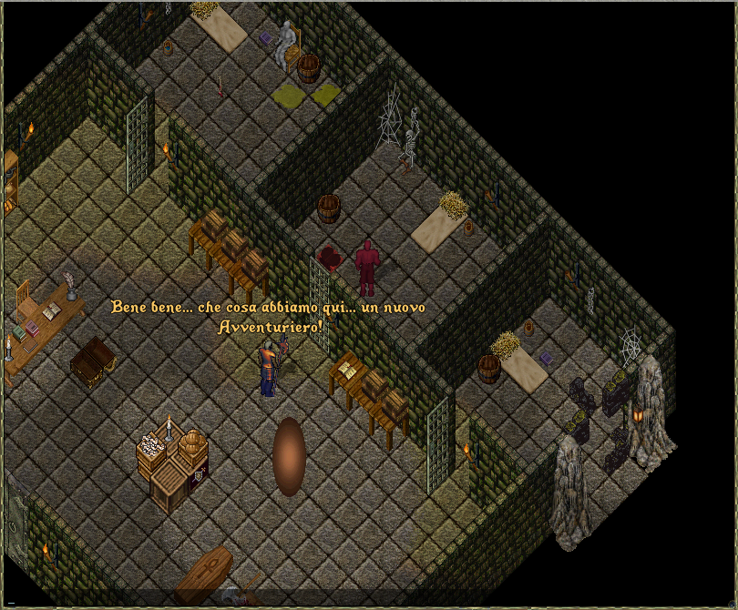
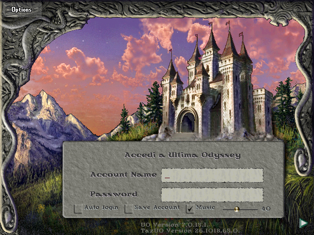
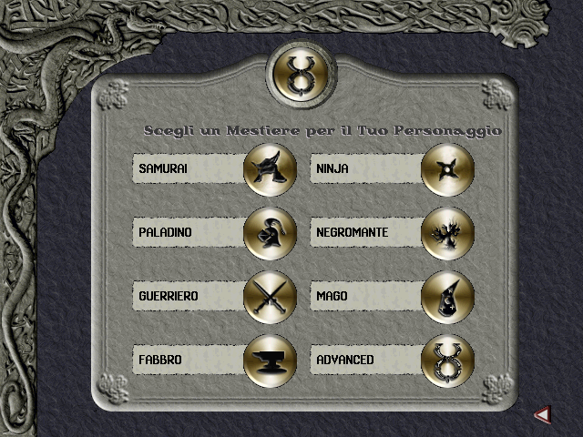
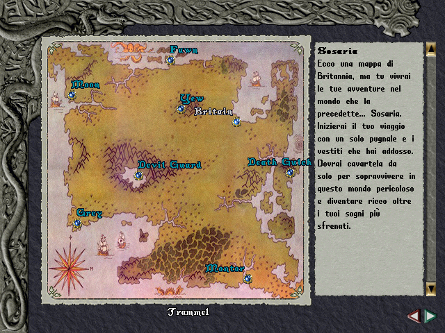
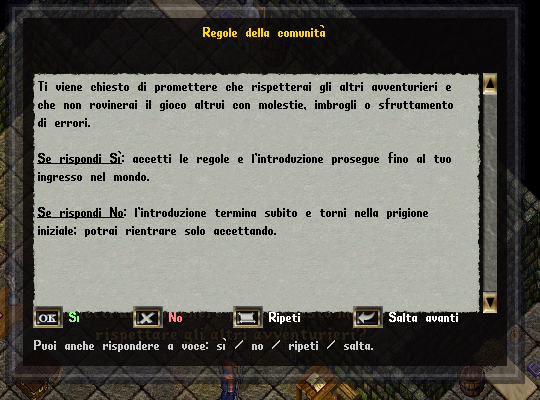
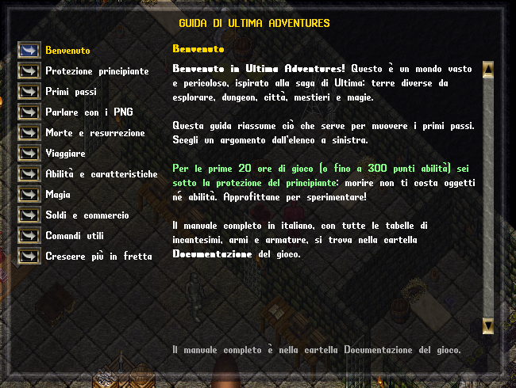
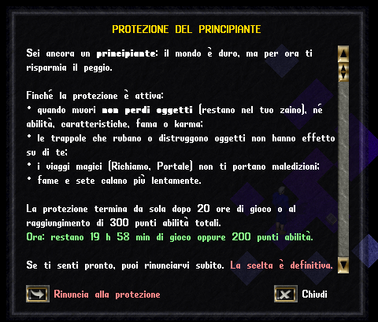
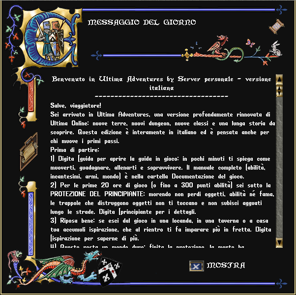
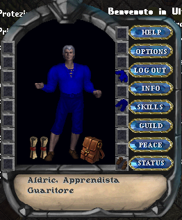

<h1 align="center">Ultima Adventures — edizione italiana</h1>

<p align="center">
  
</p>

<p align="center">
  
  
  
  
  
</p>

**Ultima Adventures** è uno shard di Ultima Online ricchissimo: tredici terre, oltre ottanta dungeon, classi speciali (Cavaliere della Morte, Sant'Uomo, Giullare, Jedi, Syth…), centinaia di manufatti e una lunga storia ambientata nel mondo di Sosaria. Questa è una sua **versione personalizzata**, che porta tre novità:

- è **interamente tradotta in italiano**, dal client ai libri del gioco;
- è **più accogliente per chi inizia**, senza perdere la sua anima di gioco di ruolo duro e persistente;
- è **pronta per un server personale su Linux**, con pacchetti di installazione per il server e per il client.

---

## Indice

- [Galleria](#galleria)
- [Novità](#novità)
  - [Traduzione italiana](#traduzione-italiana)
  - [Protezione del principiante](#protezione-del-principiante)
  - [Progressione meno ripetitiva](#progressione-meno-ripetitiva)
  - [Altre modifiche al gameplay](#altre-modifiche-al-gameplay)
  - [Guida in gioco e manuale](#guida-in-gioco-e-manuale)
  - [Correzioni di bug](#correzioni-di-bug)
- [Installazione](#installazione)
- [Configurazione](#configurazione)
- [Struttura del repository](#struttura-del-repository)
- [Come funziona la traduzione](#come-funziona-la-traduzione)
- [Crediti e licenza](#crediti-e-licenza)

---

## Galleria

| | |
|:---:|:---:|
| <br>**Schermata di accesso** | <br>**Scelta della professione** |
| <br>**Scelta della città di partenza** | <br>**Le domande dell'introduzione, con pulsanti cliccabili** |
| <br>**La guida in gioco (`[guida`)** | <br>**La protezione del principiante (`[principiante`)** |
| <br>**Il messaggio del giorno** | <br>**Titoli tradotti nel paperdoll** |

---

## Novità

### Traduzione italiana

| Parte del gioco | Voci tradotte |
|---|---:|
| Testi del server (messaggi, finestre, nomi di oggetti e creature) | 43.354 |
| Libri, pergamene e lore | 5.182 |
| Battute dei PNG nei dialoghi | 8.498 |
| Parole chiave dei dialoghi | 1.083 |
| Cliloc del client (interfaccia, oggetti, proprietà) | 19.806 |

- **I comandi si possono dire in italiano.** Il server riconosce le parole chiave italiane e le collega a quelle inglesi del gioco:

  | Funzione | Esempi |
  |---|---|
  | Banca | "banca", "saldo" |
  | Commercio | "mercante compra", "mercante vendi" |
  | Animali | "tutti seguitemi", "tutti attaccate", "resta", "libera" |
  | Maestri | "addestra", "insegna" |
  | Indovinelli | le risposte delle missioni |

- **Tradotti anche nel client:** i nomi delle abilità nella finestra Abilità (`skills.mul`), le professioni nella creazione del personaggio, l'introduzione, il messaggio del giorno e le regole.
- **Terminologia uniforme**, con un glossario comune: abilità, incantesimi e reagenti hanno sempre lo stesso nome nel gioco e nel manuale.

### Protezione del principiante

Per le prime **20 ore di gioco** o fino a **300 punti abilità** (alla prima soglia raggiunta) il mondo risparmia il peggio:

| Senza protezione | Con la protezione |
|---|---|
| Alla morte gli oggetti restano sul cadavere | Gli oggetti restano nello zaino |
| Si possono perdere abilità, caratteristiche, fama e karma | Nessuna perdita |
| Trappole che distruggono o rubano oggetti | Rese innocue |
| Maledizioni casuali usando Richiamo e Portale | Nessuna maledizione |
| Agguati casuali lungo le strade | Nessun agguato |
| Fame e sete a velocità normale | Velocità dimezzata |
| Resurrezione immediata ogni 60 minuti | Ogni 10 minuti |

Il comando `[principiante` mostra quanto manca alla fine della protezione e permette di rinunciarvi.

### Progressione meno ripetitiva

| Meccanica | Effetto |
|---|---|
| **Riposo e ispirazione** | Uscire dal gioco in una locanda, in una taverna o a casa accumula ispirazione: 4 minuti di riposo valgono 1 minuto, fino a 120. Al ritorno la probabilità di migliorare le abilità raddoppia (`[ispirazione`). |
| **Bonus varietà** | +25% alla velocità di apprendimento con almeno 4 abilità diverse usate negli ultimi 30 minuti. |
| **Fascia 80–100 ammorbidita** | Un guadagno riuscito conta con probabilità 2/3, 1/2, 1/3 e 1/4 invece di 1/2, 1/3, 1/4 e 1/5. Oltre 100 non cambia nulla. |
| **Caratteristiche** | Un aumento ogni 10 minuti invece di 15. |
| **Maestri PNG** | Insegnano fino a 50 punti invece di 42. |

### Altre modifiche al gameplay

- **Modalità non-Avatar riequilibrata.** Si impara alla stessa velocità dell'Avatar, le perdite di fama non sono più maggiorate e alla morte non si perdono mai abilità né caratteristiche.
- **Equilibrio del mondo funzionante.** Prima un errore di calcolo lo bloccava. Ora oro e robustezza dei mostri variano con l'Equilibrio intorno ai valori originali: l'oro tra il 45% e il 65% nelle zone normali, i punti ferita dei mostri entro ±20%.
- **Introduzione** con pulsanti cliccabili (Sì / No / Ripeti / Salta), risposte anche a voce in italiano e testi che spiegano le scelte.
- **Menu Compra/Vendi** sui mercanti e `[corpse` utilizzabile anche da spirito.
- **Strumenti per un server personale:**
  - pulizia del mondo dagli account del server pubblico originale;
  - promozione automatica del primo amministratore.

### Guida in gioco e manuale

- **`[guida`** apre una guida in gioco con 11 argomenti per chi inizia. Gli argomenti sono file di testo in `Server/Data/Guida/`, modificabili senza ricompilare.
- **[Manuale completo](Documentazione/Manuale.html)**: 18 capitoli e circa 300 tabelle, con indice e ricerca, consultabile offline. Le sorgenti Markdown sono in `Documentazione/Manuale/`. Contiene:
  - primi passi, comandi e meccaniche;
  - le 58 abilità;
  - professioni e classi speciali;
  - artigianato;
  - **tutti i sistemi di magia con le tabelle complete degli incantesimi**;
  - alchimia;
  - armi, armature e oggetti magici, con i 333 manufatti;
  - mondo e dungeon.

### Correzioni di bug

<details>
<summary>Elenco delle correzioni principali</summary>

**Server e Linux**
- Il server non caricava il salvataggio: confondeva i tipi `WereWolf` e `Werewolf`.
- Su Linux andava in crash inviando le finestre compresse (`libz` su Debian).
- Avviato senza terminale entrava in un ciclo di crash e riavvii.
- La mappa UltimaLive non veniva inviata a chi entrava fermo nel gioco.
- Sotto systemd, dopo un crash, il riavvio automatico creava due istanze del server.

**Gameplay**
- Il ritardo di guadagno delle caratteristiche era condiviso fra tutti i giocatori.
- Nell'introduzione "no" scattava anche con "know" e "now", e "sì" anche con "I don't".
- Lo staff non poteva avviare la scena iniziale.
- La finestra della resurrezione mostrava percentuali di perdita di fama e karma sbagliate.
- La maledizione di viaggio non colpiva mai i personaggi malvagi.

**Mosse speciali e magia**
- Le mosse Protezione da Mischia costavano mana senza alcun effetto.
- La Danza delle Lame abbassava i requisiti delle altre mosse; il Colpo Tossico non avvelenava a 100 o più di Avvelenamento.
- Il Doppio Turbine impostava il vigore invece di sottrarlo.
- Le icone delle mosse speciali del client non erano collegate.
- L'incantesimo Scaccia Demoni usava i dati di Palla di Neve.
- Il Cavaliere della Morte usava il karma del bersaglio.

**Oggetti e artigianato**
- Il bonus di Alchimia scattava già a 9,9 punti di abilità.
- I gioielli nanici consumavano lingotti di mithril.
- Gli strumenti musicali non diventavano mai ammazza-creature.

</details>

---

## Installazione

### Server (Debian / Linux 64 bit)

I file sono in [`Deploy/server-debian/`](Deploy/server-debian/LEGGIMI.txt).

```bash
sudo ./installa-server.sh ultima-adventures-server.tar.gz nome.dyndns.esempio
```

Lo script:
- crea l'utente di servizio;
- installa Mono 6.12 e il server in `/opt/ultima-adventures`;
- attiva il servizio systemd `ultima-adventures`, con riavvio automatico e backup notturni dei salvataggi.

Comandi utili:

```bash
journalctl -u ultima-adventures -f          # console del server in tempo reale
ultima-console save                         # salva il mondo
ultima-console "bc Messaggio per tutti"     # messaggio a tutti i giocatori
sudo systemctl stop ultima-adventures       # salva e spegne
```

Ricorda di aprire e inoltrare sul router la porta **TCP 2593**.

### Client (Windows 10/11 e Debian, 64 bit)

Il client consigliato è **[TazUO](https://github.com/PlayTazUO/TazUO)**, che ha build native per Windows e Linux. In [`Deploy/client/`](Deploy/client/LEGGIMI.txt) trovi:
- tre profili di collegamento: questo PC, rete locale e Internet;
- gli script di avvio, `Gioca - ….bat` su Windows e `gioca.sh` su Linux;
- `installa-collegamenti.sh` per aggiungere le voci al menu delle applicazioni su Linux.

I dati del client (cartella `Data Files` della release di Ultima Adventures, con `Cliloc.ita` e `skills.mul` tradotti) non sono inclusi nel repository per motivi di dimensione.

---

## Configurazione

| Cosa | Dove |
|---|---|
| Soglie di protezione, progressione ed Equilibrio | `Server/Scripts/MyServerSettings.cs` |
| Indirizzo pubblico del server | `Server/Data/indirizzo-pubblico.txt` (file locale) |
| Lingua e registrazione dei testi non tradotti | `Server/Data/Localization/config.txt` (`lingua=it`, `registra-mancanti=si`) |
| Argomenti della guida in gioco | `Server/Data/Guida/*.txt` |
| Messaggio del giorno e regole | `Server/Info/News.txt`, `Server/Info/Rules.txt` |
| Ripartire con un mondo pulito | creare `Server/Data/pulizia-mondo.txt` prima dell'avvio |
| Primo amministratore | `Server/Data/primo-owner.txt` (nome dell'account) |

---

## Struttura del repository

```
Server/
  Server/                 core RunUO (C#), con il motore di traduzione Localization.cs
  Scripts/                script di gioco (meccaniche, PNG, oggetti...)
  Data/Localization/it/   traduzioni: interfaccia, dialoghi, libri, parole chiave
  Data/Guida/             argomenti della guida in gioco
Documentazione/           manuale (Markdown e HTML)
Deploy/
  server-debian/          installazione del server come servizio systemd
  client/                 profili e script di avvio del client TazUO
docs/immagini/            screenshot
```

---

## Come funziona la traduzione

Il codice e i salvataggi del server restano **in inglese**: la traduzione avviene **al volo**, sui pacchetti inviati al client.

1. Ogni testo in uscita (messaggi, finestre, nomi, proprietà degli oggetti) passa da `Server.Localization`.
2. Il testo viene cercato prima nel **dizionario esatto**. Se non c'è, si confronta con i **modelli** con segnaposto (`"You have {0} gold."` → `"Hai {0} monete d'oro."`): i segnaposto possono cambiare ordine e i valori catturati vengono tradotti a loro volta.
3. I testi lunghi vengono suddivisi per righe e per tag HTML. Il motore ignora i plurali inglesi aggiunti dal codice (`ingot` + `s`) e non applica modelli troppo generici.
4. Il parlato dei giocatori non viene mai tradotto. I messaggi ASCII che contengono lettere accentate passano automaticamente al formato Unicode.

Così si può tornare all'inglese cambiando una sola riga di configurazione, e gli aggiornamenti del codice originale restano facili da integrare.

---

## Crediti e licenza

- **Ultima Adventures** è opera di FinalTwist e della comunità che l'ha sviluppato negli anni, partendo da Ultima Odyssey e RunUO.
- **Ultima Online** è un marchio di Electronic Arts. Questo progetto non è affiliato né approvato da EA.
- Traduzione, nuove meccaniche e correzioni di questa edizione: Randolph Carter.

Come il progetto originale, questa edizione è distribuita **gratuitamente** e va usata solo **senza scopo di lucro**.
